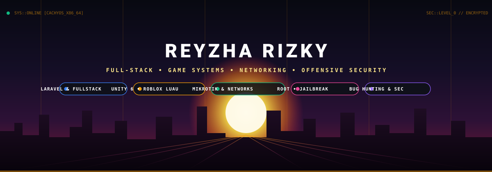
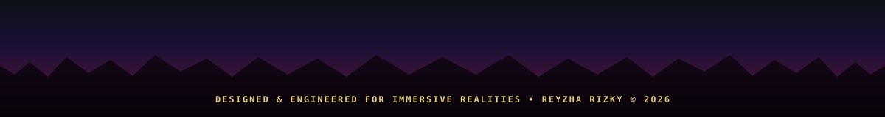

<!-- SUNSET PANORAMA HERO BANNER -->

 

<!-- ANIMATED TERMINAL PUNCHLINE -->

 

<!-- TOP HUD NAVIGATION -->

  <a href="#-overview"><code>// OVERVIEW</code></a> &nbsp;•&nbsp;
  <a href="#-tech-arsenal"><code>// ARSENAL</code></a> &nbsp;•&nbsp;
  <a href="#-selected-work"><code>// PROJECTS</code></a> &nbsp;•&nbsp;
  <a href="#-systems--shaders"><code>// SHADERS & LABS</code></a> &nbsp;•&nbsp;
  <a href="#-telemetry"><code>// TELEMETRY</code></a> &nbsp;•&nbsp;
  <a href="#-contact"><code>// DISPATCH</code></a>

<!-- LIVE STATUS INDICATORS -->

  
  
  
  

### ⚡ Overview

<table>
  <tr>
    <td width="65%" valign="top">
      

        Hey, I'm <b>Reyzha</b>. I build games and technical gameplay systems. Most of my day is spent inside <b>Unity 6</b> writing C# architecture, creating responsive character controllers, and writing custom shaders for lighting and foliage interaction.
      

      

        I focus heavily on <b>game feel and frametime stability</b>: reducing draw calls, profiling memory allocations to avoid garbage collection spikes, and keeping rendering smooth even in dense 3D scenes.
      

      <pre>
$ cat ~/profile.json
{
  "name": "Reyzha Rizky",
  "role": "Game Developer / Technical Programmer",
  "focus": ["Gameplay Mechanics", "Shader Development", "Linux Tooling"],
  "engine": "Unity 6 (Universal Render Pipeline)",
  "environment": "Arch / CachyOS (Linux Wayland)"
}
      </pre>
    </td>
    <td width="35%" align="center" valign="middle">
      
        
      <b>Reyzha Rizky</b> 
      <code>@rezariski</code> 
      <small>Game Dev • Shaders • Linux</small>
    </td>
  </tr>
</table>

### 🛠️ Tech Arsenal

| Domain | Weapons of Choice |
| :--- | :--- |
| **Engines & Frameworks** |     |
| **Core Languages** |      |
| **3D & Asset Creation** |    |
| **System & Environment** |     |

 

  

### 🚀 Selected Work & Experiments

<table>
  <tr>
    <td width="50%" valign="top">
      <h4>🌲 3D Foliage & Forest Environment</h4>
      
Universal Render Pipeline environment prototype with custom wind sway vertex shaders, dynamic day/night light transitions, and foliage density optimizations.

      

        <code>Unity 6</code> • <code>URP</code> • <code>Shader Graph</code> • <code>Lighting</code>
      

    </td>
    <td width="50%" valign="top">
      <h4>🎮 Third-Person Locomotion Controller</h4>
      
State-machine driven character movement setup featuring physics-based slope sliding, root motion blending, input buffering, and camera collision logic.

      

        <code>C#</code> • <code>Mecanim</code> • <code>Input System</code> • <code>Physics</code>
      

    </td>
  </tr>
  <tr>
    <td width="50%" valign="top">
      <h4>🎙️ Fish-TTS Desktop Audio Runtime</h4>
      
Local neural voice synthesis engine integrated into a responsive desktop client for zero-latency Indonesian/English voice generation.

      

        <code>Python</code> • <code>Electron</code> • <code>CUDA / GPU</code> • <code>Wayland</code>
      

    </td>
    <td width="50%" valign="top">
      <h4>🤖 OmO Native Multi-Agent System</h4>
      
Autonomous CLI agent workflow routed through local 9Router inference models to automate codebase refactoring, UI/UX tasks, and Unity game planning.

      

        <code>Node.js</code> • <code>9Router API</code> • <code>OpenCode</code> • <code>Arch Linux</code>
      

    </td>
  </tr>
</table>

### 🧪 Systems & Lab Experiments

  
<b>▶ Click to expand: Technical Pipeline & Architecture Notes</b>

   

  #### 🕹️ Gameplay Engineering
  - **State Pattern**: Hierarchical state machine for Player States (`Idle`, `Sprint`, `Jump`, `Fall`, `Attack`). Decoupled from input polling.
  - **ScriptableObject Architecture**: Data-driven weapon stats, inventory schemas, and event channels for zero tight-coupling between game systems.
  - **Performance Rules**: Zero `FindObjectsOfType`, zero boxing allocations in hot update loops, pre-allocated object pools for audio and particle emitters.

  #### 🎨 Shading & Rendering
  - **Custom HLSL Subshaders**: Interactive wind displacement using vertex colors as bend weight maps.
  - **Shadow & Depth Optimization**: Cascade shadow tuning and baked probe lighting for seamless indoor-to-outdoor transitions.

### 📊 Telemetry & Activity

<table>
  <tr>
    <td width="50%" align="center">
      
    </td>
    <td width="50%" align="center">
      
    </td>
  </tr>
  <tr>
    <td colspan="2" align="center">
      
    </td>
  </tr>
</table>

### 📬 Dispatch & Links

  Open for indie collaborations, gameplay programming tasks, and technical discussions.

  
  
  

 

<!-- SUNSET FOOTER WAVE -->

